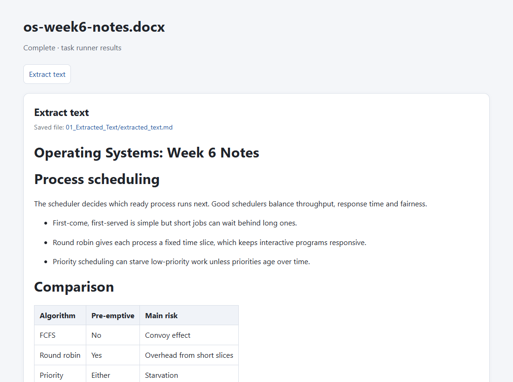
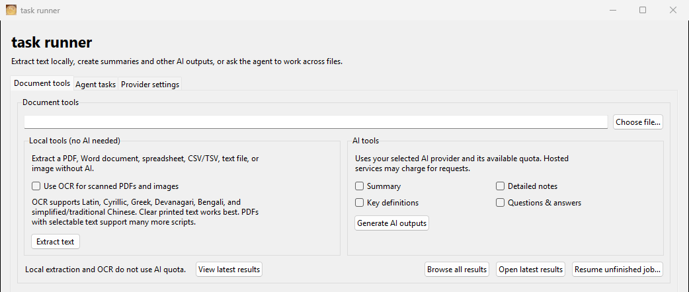

# task runner

A Windows desktop app that pulls the text out of documents, turns it into study material with an AI model of your choice, and runs small file tasks with an agent that is kept inside one folder.

Built with Python and Tkinter. Text extraction and OCR run on your own computer; only the AI features send text to a provider (Gemini, OpenAI, Anthropic, Ollama or any OpenAI-compatible server). Progress is saved as a job runs (agent tasks in SQLite, document jobs as checkpoint files), so an interrupted job can be resumed.





The results page comes from extracting a made-up Word document, without an AI provider.

## What it does

- Extracts text from PDFs, Word documents, spreadsheets, CSV/TSV, text and Markdown files and images, keeping headings, lists and tables where it can.
- Optional local OCR for scanned PDFs and photos. The model downloads the first time you use it.
- Generates summaries, detailed notes, key definitions and practice questions with the AI provider you configure.
- Agent tasks: ask it to look through, compare or combine text files in a folder you pick and save the result there. It can't leave that folder, asks before overwriting anything, and can't run commands or programs.
- Shows the results as a formatted page in your browser, next to the saved Markdown and text files.

## Download for Windows

Download the latest **Windows x64 ZIP** from [GitHub Releases](../../releases/latest). Extract the whole `task-runner` folder and run `task-runner.exe`. Keep the other files in that folder, because the executable needs them. You don't need to install Python.

Releases are unsigned unless the release notes say otherwise. See [CODE_SIGNING_POLICY.md](CODE_SIGNING_POLICY.md) for the details.

## Using it

- **Document tools:** pick a file and choose **Extract text**. Turn on OCR for scanned pages or images, and pick AI outputs only when you want generated content.
- **Results:** after a job, choose **View in browser**, **Open results folder** or **Not now**. You can reopen the preview later, and the saved Markdown and text files are there to copy.
- **Agent tasks:** describe what you want and pick a working folder. If you don't know the filenames, ask the agent to list the files first.
- **Provider settings:** set up the AI provider and credentials used for AI outputs and agent tasks.

Local extraction and OCR never send document contents to an AI provider. An AI output or agent task sends the relevant text to the provider you configured.

## Run from source

Python 3.13 (64-bit) works best, mainly for the optional OCR. From the repository root in PowerShell:

```powershell
py -3.13 -m venv .venv
.\.venv\Scripts\python.exe -m pip install --upgrade pip
.\.venv\Scripts\python.exe -m pip install -e ".[dev,documents]"
.\.venv\Scripts\python.exe -m runtime.gui
```

For the optional OCR dependencies:

```powershell
.\.venv\Scripts\python.exe -m pip install -e ".[ocr]"
```

The first OCR run needs an internet connection to download the model. Normal text extraction doesn't need OCR.

## Tests

From the repository root:

```powershell
.\.venv\Scripts\python.exe -m pytest -q
```

The tests use local fixtures, temporary folders and simulated provider responses. They cover task saving and recovery, the workspace limits, the overwrite checks, provider errors, document extraction and the GUI workflows. No test calls a live AI provider or uses API quota, so they don't check a real API key, whether a model is available, the network, or OCR quality on a particular image.

## Build the Windows application

On a 64-bit Windows computer with 64-bit Python 3.13, double-click `packaging\build-windows.bat`. It creates a build environment, installs the dependencies, runs the tests and packages the app into:

- `dist\task-runner\task-runner.exe` and its supporting files.
- `dist\task-runner-windows-x64.zip`, the bundle for distribution.

Pushing a `v*` tag runs the same build in GitHub Actions and publishes a release.

## Data and configuration

- `.env.example` is the template and holds no real credentials.
- `.env` is your private configuration and Git ignores it. When you run from source, the **Provider settings** page creates and updates it.
- Running from source keeps settings, task data and the default workspace in the project folder. The packaged app uses `%LOCALAPPDATA%\task-runner`.
- `data/`, the workspace contents, environment folders and build output are not in Git.

See [PRIVACY.md](PRIVACY.md) for how data is handled and [THIRD_PARTY_NOTICES.txt](THIRD_PARTY_NOTICES.txt) for the dependency and model notices.

## Project layout

| Path | Contents |
| --- | --- |
| `runtime/` | The app: `gui.py` (window), `documents.py` (extraction and AI outputs), `engine.py` (plans and runs agent tasks), `tools.py` (the tools the agent may use), `providers.py` (AI provider adapters), `storage.py` (SQLite task history), `results_view.py` (results page), `settings.py` and `config.py` (settings), `cli.py` (command line) |
| `tests/` | pytest tests and fixtures |
| `packaging/` | Windows build scripts and the PyInstaller spec |
| `workspace/` | Example workspace for agent tasks |
| `assets/`, `docs/` | Icons and screenshots |
| `.github/workflows/` | The release build |

## Limitations

- Extraction tries to keep reading order, headings, paragraphs and tables, but it doesn't reproduce the page layout. Multi-column pages, merged or complex tables, charts, floating objects, handwriting and poor scans can come out wrong, so check important values against the source.
- OCR quality depends on the language, image clarity, font and layout.
- Agent tasks work with text files in the workspace folder. They can't run code or shell commands.

## License

Apache License 2.0 for the source code. See [LICENSE](LICENSE). Third-party packages and the optional OCR model weights can have their own licenses; see [THIRD_PARTY_NOTICES.txt](THIRD_PARTY_NOTICES.txt).
